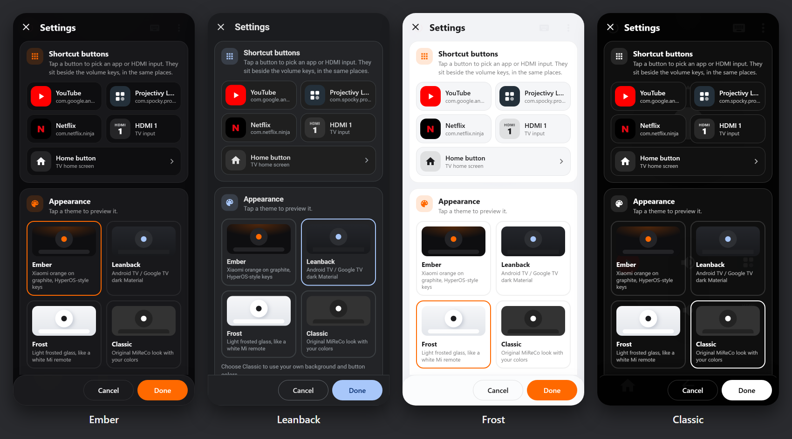
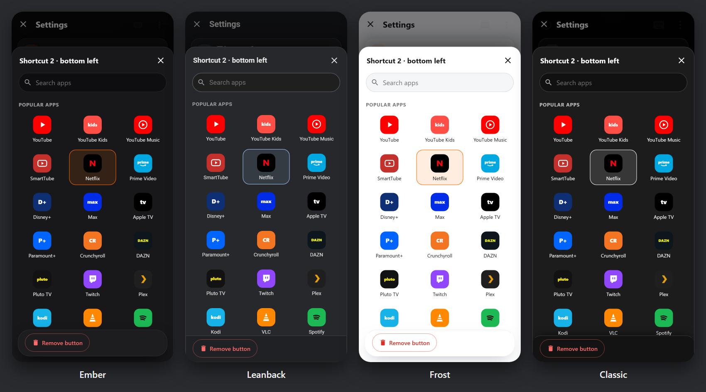
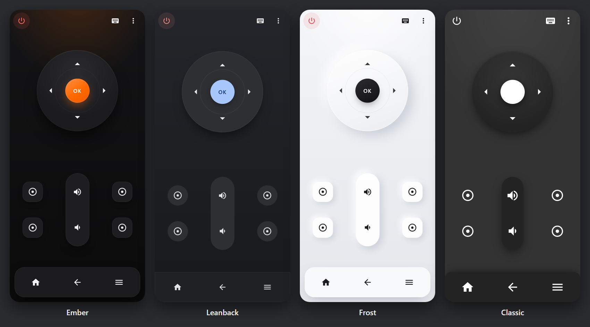
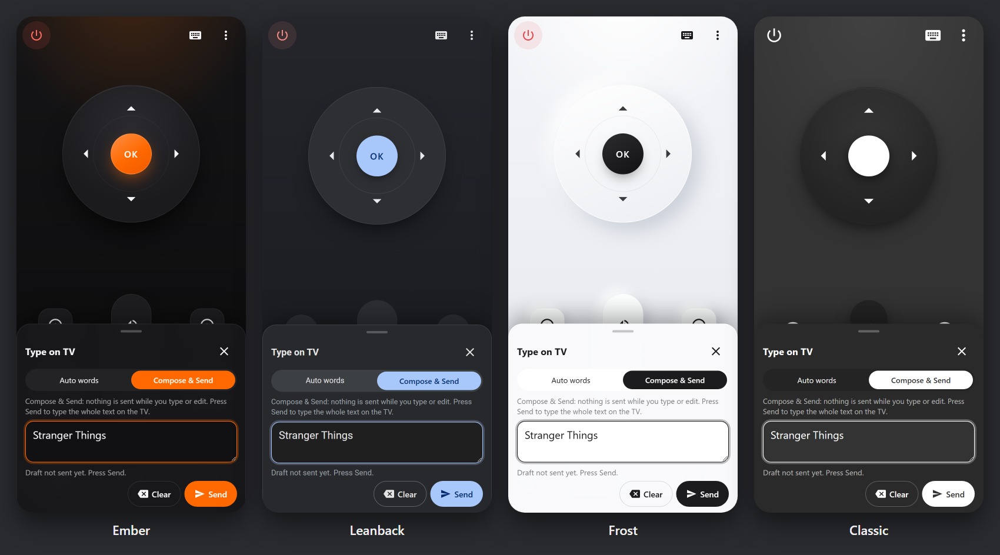

# MiReCo - Xiaomi GiTV Remote Control

Simple web based remote control for MIUI TV based android devices such as Mi Box, Mi Tv, Mi Projectors...

No need to install anything special on your controlled device, this website/webapp communicates with the GiTV internal web server to send events to your device.

Requests go **directly from your browser to the TV** on your local network. There is no backend, proxy, analytics or telemetry, and the page's Content Security Policy only allows network connections to port 6095 (the GiTV API).

It probably won't work on international firmwares such as Android Tv 8.x (but if it does, please keep me informed)

Depending on your device, you'll need to have one the the 2 services enabled for it to work (enabled by default) :
- com.duokan.airkan.tvbox (AirkanTvService)
- com.xiaomi.mitv.remotecontroller.service (RemoteControllerService)
So if you have disabled "bloatware" (using "pm uninstall ...." for example), please make sure these services are still installed/enabled.

## Usage
* Open the site on your phone (your GitHub Pages URL, see [deployment](#deploying-to-github-pages)).
* Open settings (⋮), enter your TV's IP address (TV settings → Network) and tap **Test connection**. When Chrome asks whether the site may access devices on your local network, choose **Allow**.
  * Only local addresses are accepted: `192.168.x.x`, `10.x.x.x`, `172.16–31.x.x`, `169.254.x.x`, `127.x.x.x` / `localhost` (for the mock device), or a `.local` name.
  * "Test connection" can only tell you that *something answered* on port 6095. The TV's responses can't be read by the page (no CORS), so MiReCo never claims a command was executed — check the TV screen.
  * You can also pass the IP in the URL once: `https://…/mireco/#192.168.1.20`.
* Use the settings to configure :
 * 4 shortcut buttons (see [Shortcut buttons](#shortcut-buttons)), each launching an app or switching to an HDMI input (please note that as of GiTV 1.3.97, HDMI3 is not supported by the GiTV server, thus it won't work until Xiaomi fixes it).
 * the home button: TV home screen, or a launcher app (if you installed a custom launcher but didn't disable the stock one, which is still bound to the home button)
 * a theme (see below), and background and buttons colors for the Classic theme
 * vibrate on touch
 * typing options: delay between keys, experimental non-ASCII characters
* Settings are stored in the browser's `localStorage` (they used to be cookies, which on GitHub Pages would be sent to github.io and shared with other `USER.github.io` sites; old cookies are migrated automatically).
* This app is compatible with webapp standard, so adding it to your home screen from the browser menu gives it its own icon and removes the address bar.

### Shortcut buttons
Settings → *Shortcut buttons* shows the four buttons where they sit on the remote (two left and two right of the volume keys). Tap one to open the app picker:

* **Popular apps**: YouTube, YouTube Kids, YouTube Music, SmartTube, Netflix, Prime Video, Disney+, Max, Apple TV, Paramount+, Crunchyroll, DAZN, Pluto TV, Twitch, Plex, Kodi, Stremio, VLC, Spotify, Play Store and two launchers. Each one comes with its own colored icon and its usual Android TV package name. The search box filters by app or package name.
* **TV inputs**: HDMI 1–3.
* **Other app**: type any package name, for example from the app's Play Store address (`id=…`), and choose an icon: automatic, one of eight generic icons (apps, movies, live TV, music, games, web, favorite, settings), or up to three letters.
* **Remove button** hides the button on the remote.

*Home button* works the same way, with a choice of the TV home screen, a known launcher (Projectivy, FLauncher) or any other package.

App icons are simple colored tiles drawn for MiReCo, not official logos. Package names can differ between regions and firmware builds; if a button doesn't open the app, enter its package under *Other app*.

The settings screen keeps your edits in a draft: **Save** stores them, **Cancel** (or ✕, or Escape on a keyboard) discards them, and an *Unsaved* chip shows when something changed.





### Themes
Pick one in Settings → Appearance; tapping a theme previews it immediately, Cancel restores the saved one.

| Theme | Style |
|---|---|
| **Ember** (default) | Xiaomi orange on graphite, HyperOS-style squircle keys, glowing orange OK key, floating frosted dock |
| **Leanback** | Android TV / Google TV: calm slate surfaces, Material 3 tones, round keys, light-blue OK key, edge-to-edge navigation bar |
| **Frost** | Light theme like a white Mi remote: frosted glass, soft raised keys, dark OK key |
| **Classic** | The original MiReCo look, using your own background and button colors |





People who already had MiReCo settings stay on Classic until they choose another theme. The theme is applied before the page first paints (`js/theme-boot.js`), so there's no flash of the wrong theme. All themes use system fonts; nothing is loaded from third parties.

### If a command fails
A short message explains the likely cause: Local Network Access denied (re-allow it in Chrome: icon left of the address → Permissions/Site settings → *Local network access*), unsupported browser, TV off/asleep or wrong IP, or a timeout (in which case the command *may* still have run). Errors aren't repeated for every key press.

## Typing text on the TV

Tap the **keyboard** icon (top right) to open the text panel. The remote stays usable above it, and pressing remote buttons while typing doesn't close the phone keyboard.

The GiTV API only takes one key per request and has no verified "delete character" key, so anything that reaches the TV can't be taken back. Phone keyboards (Gboard, SwiftKey, Samsung Keyboard) constantly rewrite the word you're typing (suggestions, autocorrect, swipe, voice), so MiReCo never mirrors the field character by character. Two modes:

* **Auto words** (default). The word you're typing stays in the field and can be changed freely by suggestions/autocorrect. When the field contains a finished word followed by a space or Enter, and the keyboard has been quiet for ~0.7 s with no composition in progress, everything up to that space is queued and removed from the field; the unfinished word stays. **Send** sends the rest, including the last word.
  *Example:* type `hel` (nothing sent) → pick the suggestion `hello` → the keyboard adds a space → `hello ` is sent once. Then `wor` → pick `world` → Send → the TV receives `hello world`, never `helhello`.
* **Compose & Send**. Nothing is sent while you type, paste, dictate or edit anywhere in the text. **Send** types the whole text. Use this for passwords, long text, or whenever you want to edit freely.

The selected mode is remembered. Ctrl+Enter sends on a physical keyboard.

Details and guarantees:
* Text is cleared from the field only after it was accepted by the send queue. Unsupported characters, a missing IP or a full queue leave the text in the field with an explanation.
* Keys are sent strictly in order, one request at a time, with a configurable gap (default 80 ms). You can keep typing while earlier words are still being sent. Remote buttons pressed meanwhile are sent **after** the queued text (actions reach the TV in the order you did them). **Stop** cancels queued keys.
* If a key fails, the rest of that text is cancelled (not sent with a gap), nothing is retried automatically (the TV may have received it), and the unsent part is offered back with **Put back in draft** so you can retry it explicitly.
* At most 300 characters per send and 400 queued requests, to avoid accidental huge pastes.
* Line breaks (Enter in the text field) are sent as the `enter` key. Multiple spaces are kept. `&`, `+`, `#`, `%`, `?` etc. are percent-encoded and arrive as literal characters. Words that look like key names (`back`, `home`) are typed letter by letter, so they can't trigger navigation.
* Supported by default: printable ASCII. Accented letters (`á`, `ñ`, …) can be enabled in settings as *experimental*; emoji, combining marks and control characters are always refused rather than silently dropped or replaced.
* Closing the panel never discards anything: the draft stays (the keyboard icon shows a dot) and queued keys keep sending.

Limitations of Auto words:
* Once a word has been sent, the keyboard can no longer change it on the TV. If you backspace into text that was already sent, MiReCo tells you instead of guessing. Gboard's "undo autocorrect" or double-space-period after the ~0.7 s pause therefore only affect the field, not the TV. Use Compose & Send if you need full editing.
* While you type continuously, the previous word is sent at the next short pause (MiReCo never modifies the field during an IME composition).

## Browser compatibility

The page is meant to be served over **HTTPS** (for example GitHub Pages) while the TV's API is plain **HTTP** on the LAN (`http://TV_IP:6095`). Browsers normally block that as *mixed content*. Chromium's [Local Network Access](https://developer.chrome.com/blog/local-network-access) (LNA) feature is what makes it work: the browser asks once for permission to reach devices on your local network, and once granted it allows requests to private IP addresses and `.local` names even from HTTPS pages.

| Browser | HTTPS page (GitHub Pages) | Local/LAN HTTP page |
|---|---|---|
| Chrome for Android, Chrome/Edge desktop **142+** | ✅ after you allow "local network access" | ✅ |
| Firefox, Safari / any iOS browser, older Chrome | ❌ blocked as mixed content | ✅ use the [HTTP version](#http-version-iphone-safari-firefox) |

Chrome on Android is the primary target. The settings screen (⋮ → *How this page reaches your TV*) shows how the current page is served and the current LNA permission state.

### Why the old "host it on HTTP" advice no longer applies everywhere
The original MiReCo had to be served over plain HTTP (`http://mireco.hopto.org`) to avoid mixed-content blocking. Current Chrome and Edge now apply Local Network Access to *insecure public* sites too, and such sites can't be granted the permission at all, so a public HTTP copy is blocked. The two configurations that work today are: **HTTPS + an LNA-capable browser**, or **a copy served from your own network** (localhost or a LAN IP over HTTP).

## Local and LAN preview

Requires Node.js 20+ (no runtime dependencies; `npm install` only creates the lockfile).

```bash
npm install
```

| Command | URL | Use it for |
|---|---|---|
| `npm run preview` | `http://localhost:8080` | Desktop UI development |
| `npm run preview:lan` | `http://<PC-LAN-IP>:8080` | Phone layout, Android keyboards, real TV control over HTTP |
| `npm run preview:https:lan` | `https://<PC-LAN-IP>:8443` | Closer-to-production HTTPS testing from the phone |
| `npm run preview:https` | `https://localhost:8443` | HTTPS on the PC only |
| `npm run mock-device` | `http://<PC>:6095` | Fake TV that prints the received keys/text |
| `npm run build` | `dist/` | Deployable copy of the site (see [HTTP version](#http-version-iphone-safari-firefox)) |
| `npm run serve:http` | `http://<PC-LAN-IP>:8080` | Builds and serves `dist/` over HTTP for everyday use on your network |

The LAN commands print every LAN URL of the computer. Use a different port with e.g. `npm run preview:lan -- --port 9000`. The preview server only serves the site's files (no dotfiles, `certs/`, `scripts/`, `tests/`, `node_modules/` or package files) and sends `Cache-Control: no-store`. LAN preview is intended for trusted networks only.

### What each mode can and can't validate
These are **not** equivalent for browser-security testing:

* **Localhost HTTP** — UI, settings, keyboard logic with a physical keyboard, and the full request path with `npm run mock-device` (set the device IP to `127.0.0.1`). No mixed content, and LNA doesn't apply from localhost, so it says nothing about GitHub Pages.
* **LAN HTTP** — mobile layout, Android keyboards (Gboard autocomplete, swipe, voice), and controlling the real TV. The page is itself on the local network, so there is no mixed content and no LNA prompt (local → local). It does **not** validate HTTPS-to-HTTP mixed-content behaviour or the permission flow; success here doesn't prove GitHub Pages will work.
* **LAN HTTPS** (trusted dev certificate) — exercises HTTPS, mixed content and the secure-context requirements. Chrome may still classify a LAN-IP origin as *local* rather than *public*, so the public-origin LNA permission prompt may not appear exactly as on GitHub Pages. On desktop Chrome you can force the public behaviour with `--ip-address-space-overrides=<PC-LAN-IP>:8443=public`.
* **GitHub Pages HTTPS** — the real thing. Always do a final test on the deployed site with a supported browser and the real TV.

### HTTPS LAN preview (certificates)
`preview:https*` needs a certificate and key in `certs/dev-cert.pem` / `certs/dev-key.pem` (or `--cert/--key`, or `MIRECO_CERT`/`MIRECO_KEY`). It refuses to start without them and never falls back to HTTP. `certs/` and key/cert files are git-ignored — never commit them.

1. Install [mkcert](https://github.com/FiloSottile/mkcert) (Windows: `winget install FiloSottile.mkcert`; macOS: `brew install mkcert`; Linux: see its README) and run once:
   ```bash
   mkcert -install
   ```
2. Create a certificate for localhost and all of the computer's LAN IPs (add extra names/IPs after `--`):
   ```bash
   npm run certs
   ```
   (Equivalent manual command: `mkcert -cert-file certs/dev-cert.pem -key-file certs/dev-key.pem localhost 127.0.0.1 ::1 192.168.1.50`.) Re-run it if your LAN IP changes.
3. Trust the mkcert root CA on the phone. `mkcert -CAROOT` prints the folder; copy `rootCA.pem` to the phone as `rootCA.crt`, then on Android: *Settings → Security & privacy → More security settings → Encryption & credentials → Install a certificate → CA certificate* (wording varies by vendor). Chrome for Android honours user-installed CAs; Android may show a "network may be monitored" notice. Remove the CA when you're done testing. **Never share `rootCA-key.pem`.**
4. `npm run preview:https:lan` and open `https://<PC-LAN-IP>:8443` on the phone.

A locally trusted development certificate is not the same as GitHub Pages' publicly trusted certificate: it only works on devices where you installed the mkcert CA. Clicking through a certificate warning instead of trusting the CA is not representative (some browser features behave differently on such pages).

### Finding the computer's LAN IP
The preview server prints it. Otherwise: Windows `ipconfig` (IPv4 address of the Wi-Fi/Ethernet adapter), Linux `hostname -I` or `ip -4 addr`, macOS `ipconfig getifaddr en0`. Use an address like `192.168.x.x`, not a WSL/Docker/VPN adapter address (`172.2x.x.x` inside WSL is usually internal).

### Troubleshooting LAN preview
* **Same network**: phone and computer must be on the same Wi-Fi/LAN; guest networks and "AP/client isolation" block device-to-device traffic.
* **Windows Firewall**: allow Node.js when Windows asks (tick *Private networks*), make sure your Wi-Fi profile is *Private*, or add a rule from an elevated PowerShell:
  ```powershell
  New-NetFirewallRule -DisplayName "MiReCo preview" -Direction Inbound -Protocol TCP -LocalPort 8080,8443,6095 -Action Allow -Profile Private
  ```
* **WSL2**: by default WSL2 runs behind NAT, so a server started inside WSL is reachable from Windows (`localhost`) but **not from your phone**. Options, simplest first:
  1. Run the preview from Windows itself: install Node.js for Windows and run `npm run preview:lan` in PowerShell from a Windows checkout of the repository (npm scripts can't run from a `\\wsl$\…` UNC path).
  2. Windows 11 22H2+: enable mirrored networking in `%UserProfile%\.wslconfig` (`[wsl2]` → `networkingMode=mirrored`), run `wsl --shutdown`, restart WSL, and allow the port in the firewall (Hyper-V firewall may also need `Set-NetFirewallHyperVVMSetting -Name '{40E0AC32-46A5-438A-A0B2-2B479E8F2E90}' -DefaultInboundAction Allow`).
  3. Forward the port from an elevated PowerShell (the WSL IP changes on restart): `netsh interface portproxy add v4tov4 listenport=8080 listenaddress=0.0.0.0 connectport=8080 connectaddress=<output of: wsl hostname -I>`.
* **Diagnosing**: first open `http://localhost:8080` on the computer; then from the phone open `http://<PC-LAN-IP>:8080`. If the server logs nothing when the phone tries, the request isn't reaching the computer (firewall, isolation, WSL NAT, wrong IP). If the phone can open the site but the TV doesn't react, check the TV IP with **Test connection**.

### Testing without a TV
`npm run mock-device` starts a fake GiTV API on port 6095 that logs every command and shows the text it "typed". Set MiReCo's device IP to `127.0.0.1` (page on the same PC) or to the PC's LAN IP (page on the phone). Use `-- --delay 300` to simulate a slow device.

## HTTP version (iPhone, Safari, Firefox)

iPhone and iPad browsers (all of them use Safari's engine), desktop Safari and Firefox don't support Local Network Access. They block the HTTPS site (GitHub Pages) from sending requests to the TV's `http://` address as mixed content, and there is no setting to allow it. In those browsers, MiReCo has to be loaded over plain **HTTP** from a machine on your own network. An HTTP page talking to an HTTP device on the same network isn't mixed content, and it works in every browser, including current Chrome.

The site is plain static files, so any always-on device on your network can host it: a PC, a Raspberry Pi, a NAS, or a router that runs Docker or a web server. Only the phone's browser talks to the TV; the host just hands out the files.

`npm run build` creates `dist/` with only the files the app needs. It leaves out scripts, tests, docs and package files, and it checks that every referenced asset and module is included. Pick one way to serve it:

**A. Node.js (Windows, macOS, Linux):**
```bash
npm run serve:http
```
This rebuilds `dist/` and serves it on all interfaces at port 8080 (`npm run serve:http -- --port 9000` to change it). It prints the addresses to open on the phone. On Windows, allow it through the firewall the first time (see [Troubleshooting LAN preview](#troubleshooting-lan-preview)).

**B. Docker (NAS, Raspberry Pi, home server):**
```bash
docker compose up -d --build
```
This uses `compose.yaml` and the `Dockerfile`: a Node stage runs the build, then the files are served by nginx (`deploy/nginx.conf`) on port 8080, and the container restarts automatically. Without Compose: `docker build -t mireco . && docker run -d -p 8080:80 --restart unless-stopped mireco`.

**C. Start automatically on Linux (systemd):** clone the repository to `/opt/mireco` and run `node scripts/build.mjs`. Then install [`deploy/mireco.service`](deploy/mireco.service) (the steps are in the file). It runs the same Node server as a sandboxed service on port 8080.

**D. Start automatically on Windows:** from an elevated PowerShell in the repository, run:
```powershell
powershell -ExecutionPolicy Bypass -File deploy\install-windows-task.ps1
```
This builds `dist/` and registers a scheduled task that serves it at startup (no window, even before you log in). It also adds a firewall rule for private networks. Add `-Port 9000` to change the port, and `-Remove` to undo everything.

**E. Any web server you already have** (nginx, Apache, Caddy, IIS, a NAS's "Web Station"): copy the contents of `dist/` into a folder it serves over HTTP. A sub-folder works too, because all paths are relative. For a quick test with Python: `python3 -m http.server 8080 -d dist`.

**On the iPhone:** open `http://<host-LAN-IP>:8080` in Safari, set the TV's IP in Settings, then use Share → **Add to Home Screen** to get a full-screen app icon. The address bar shows "Not Secure". That's expected for HTTP, and the page only contains the remote's static files.

Notes:
* Give the host a fixed LAN address (a DHCP reservation in your router) so the bookmark and home-screen icon keep working.
* Keep it on your local network. Don't forward the port to the internet: it isn't needed, because the phone and TV must be on the same network anyway.
* A public plain-HTTP site (like the original `http://mireco.hopto.org`) would also work on iPhone/Safari/Firefox, but not in current Chrome or Edge, which block insecure public pages from reaching local devices. GitHub Pages always redirects `github.io` to HTTPS, so it can't serve the HTTP version.
* Updating: pull the new version, then run `npm run serve:http` (or `docker compose up -d --build`, or the Windows script) again.
* When the HTTPS site is opened in a browser without Local Network Access, MiReCo says so at once and points to this section.
* iOS hasn't been tested on a real device yet; see [docs/manual-testing.md](docs/manual-testing.md).

## Deploying to GitHub Pages
The site is plain static files with relative paths, so it works from `https://USERNAME.github.io/REPOSITORY/` without a build step or workflow.

1. Push the branch you want to publish (e.g. `master`) to your fork.
2. On GitHub: *Settings → Pages → Build and deployment → Source: Deploy from a branch*, choose the branch and the **`/ (root)`** folder, Save.
3. Make sure **Enforce HTTPS** is ticked (it is by default for `github.io`).
4. Open `https://USERNAME.github.io/REPOSITORY/` on your phone in Chrome, configure the TV IP and allow local network access.

Notes:
* The upstream `CNAME` (`mireco.hopto.org`) has been removed; that domain belongs to the original author. To use your own domain, add it under *Settings → Pages → Custom domain* (GitHub creates a `CNAME` file) and configure DNS.
* `.nojekyll` makes Pages serve the files as-is. Development files (`scripts/`, `tests/`, `package.json`) are published too but are inert.
* The web manifest uses relative `start_url`/`scope` (`./`), so "Add to Home screen" works under the repository subpath.

## Development
```bash
npm test          # unit + scenario tests (Node's built-in test runner, no dependencies)
npm run check     # syntax check of all JavaScript files
npm run verify    # both
```
Code layout (native ES modules, no framework):

| File | Responsibility |
|---|---|
| `js/address.js` | Device address validation (local/loopback only) |
| `js/commands.js` | GiTV endpoints and strict URL encoding |
| `js/transport.js` | `fetch` transport (no-cors, timeouts, LNA hints), page-origin classification, error explanations |
| `js/command-queue.js` | Ordered FIFO dispatcher (interval, bounds, cancellation, no retries) |
| `js/text-encoding.js` | Text → key events (code points, `\n` → `enter`, unsupported characters) |
| `js/text-input.js` | Word buffering / composition handling for the text field |
| `js/text-sender.js` | Committed text → queued commands |
| `js/keyboard-panel.js` | Keyboard sheet UI |
| `js/settings.js` | Settings (localStorage, cookie migration) |
| `js/settings-panel.js` | Settings screen: draft/save/cancel, shortcut slots, app picker |
| `js/apps.js`, `js/app-icons.js` | App/HDMI catalog, icon choices, icon rendering |
| `js/themes.js`, `js/theme-boot.js` | Theme list/application; pre-paint theme loader |
| `js/app.js` | Remote buttons, status messages, wiring |
| `scripts/` | Preview/static server, build, certificate helper, mock device, syntax check |
| `Dockerfile`, `compose.yaml`, `deploy/` | HTTP version hosting: Docker + nginx, systemd unit, Windows startup task |

Hardware-dependent behaviour is listed in [docs/manual-testing.md](docs/manual-testing.md).

## Known issues:
* As explained above, shortcuts won't work to change to HDMI3 (at least it doesn't work on GiTV 1.3.97, hopefully it'll be fixed by Xiaomi)
* "Vibrate on touch" setting won't work on iOs (until Apple adds support)
* Power button will only work to power off. Powering On by HTML isn't supported. On my hardware (Mi Laser Projector), wake on lan doesn't work either. For now, I haven't been able to find out how official Mi Remote app wakes the device up (it might be using mDNS, but it's not discovered by standard Bonjour apps). Please contact me if you know how it works.
* The HTTPS site needs a browser with Local Network Access support (Chrome/Edge 142+). Firefox, Safari and all iOS browsers block it as mixed content; use the [HTTP version](#http-version-iphone-safari-firefox) there.
* The TV's replies can't be read (no CORS headers), so success of individual commands can't be confirmed.
* Typing: which characters GiTV accepts in `keycode` beyond plain ASCII letters, digits and punctuation (space, symbols, accented letters) has not been verified on all firmwares. Already-sent text can't be corrected (no verified delete key).
* IPv6 device addresses aren't supported.

## GiTV http API features/"documentation"
Here are a few commands that work fine on my hardware
* **`http://DEVICE_IP:6095/controller?action=getinstalledapp&count=999&changeIcon=1`** Returns a json containing the installed apps
* **`http://DEVICE_IP:6095/controller?action=keyevent&keycode=%s`**
Sends a keypress to the device.
Put a character as keycode to send it.
A few keywords can replace the keycode :
  * **power** : turns the device off
  * **up/down/left/right** : goes up/down/left/right
  * **enter** : validate/ok
  * **home** : returns to home screen
  * **back** : goes back
  * **menu** : opens option menu
  * **volumeup** : increases volume
  * **volumedown** : decreases volume
* **`http://DEVICE_IP:6095/controller?action=startapp&type=packagename&packagename=%s`**
Launches the 'packagename' app on the device
* **`http://DEVICE_IP:6095/controller?action=changesource&source=%s`**
Changes to source "HDMI1" or "HDMI2"
* **`http://DEVICE_IP:6095/general?action=getVolum`**
Returns a json containing the current volume (MiReCo uses it as a harmless connectivity probe)

A few other commands exists, but they are specific to chinese apps or need internal signature and are not worth reversing.

Icons: [Material Icons](https://github.com/google/material-design-icons) (Apache License 2.0), inlined as SVG.
